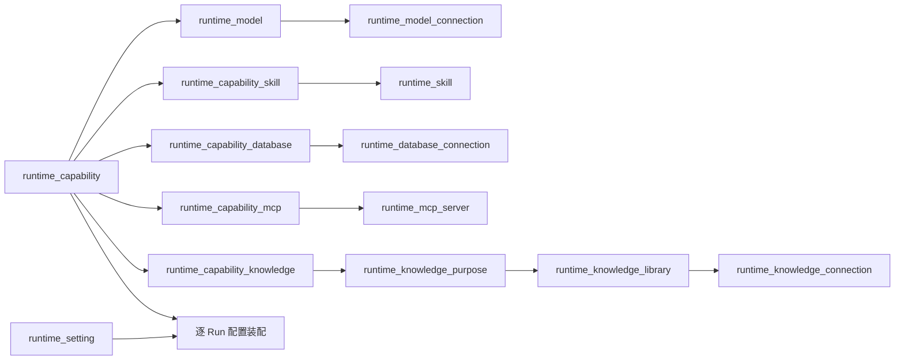

# Runtime 配置中心

MySQL 为唯一可编辑配置来源；2026-11-13 用户要求替代 Nacos，见 [ADR-039](../ADR/039-mysql-runtime-configuration.md)。启动引导、秘密及热更新边界统一见 [配置说明](../../config/README.md)。

## 表关系

共十四张表，以稳定 ref 引用。能力保留 `ref/name/description/enabled/supports_attachments/prompt/model_ref/config` 八列，和关联在同一事务保存。能力关联知识用途，不直接绑定供应商库；运行时按租户解析私有库与共享库。MCP `allowed_tools` 明确列出允许的操作，空列表不授权操作，`*` 表示该 MCP 的全部操作。

## 管理入口

`/internal/config/v1/{resource}` 支持 GET 列表；`/{resource}/{ref}` 支持 GET、PUT 完整保存、PATCH 局部保存、DELETE。资源为 capabilities、skills、models、model_connections、database_connections、mcp_servers、knowledge_connections、knowledge_purposes、knowledge_libraries、settings。GET 单条能力包含 skills/databases/mcps/knowledge。PATCH 省略字段保留原值；`config` 和 setting 的 `value` 递归合并对象、替换数组，`[]` 清空列表，文档内部的 `null` 删除可选键。显式传入关联数组也替换该组。ref 不可修改，PATCH 不创建记录。引用中的连接、基础设置和 conversation 不可删除。新 Skill 只接受文本资源。

管理 JWT 使用 `settings/security` 的 `secrets.configurationJwtSecret`，HS256，aud=ccsdk-config，scope=configuration.manage，iss 与 `value.runtimeJwtIssuer` 一致，包含 sub/iat/exp，最长 300 秒。拒绝浏览器 Origin，第三方可信后端负责签发和授权。管理读取脱敏，`configured_secrets` 表示是否配置；PUT/PATCH 的秘密字段传 null 保留原值。

GET /internal/config/v1/models 支持 connection_ref、enabled 过滤，按 sort_order、ref 排序；同连接的 model_name 唯一。GET /internal/config/v1/options 返回 models、tools、skills、mcp_servers、database_connections、knowledge_connections、knowledge_purposes、knowledge_libraries 选项；只列启用资源，模型还要求连接启用。内部 Service 可通过 MCP 资源接口管理连接，但不能作为通用 Tool 或 MCP 关联选择。模型下拉属于管理端，普通 Run 仍只能提交 Capability。

基础设置按 `runtime/files/images/security` 四组各存一行，每行用 `value` 保存 JSON、`secrets` 保存加密内容。能力的 `config.runtime` 存推理与预算，`config.attachments` 存输入限制。能力专属参数归 `config.params`，由同名代码包声明允许的键，校园查询的 `max_calls` 和 `minimum_schools` 同时用于提示词、工具 Schema 和执行校验。撰写用 `config.templates` 保存模板 key 数组；例如 `["szpt-midterm"]`。模板路径、文档与数据来源由服务端登记和校验。

字段错误返回 HTTP 400，detail 包含 resource/ref/field/code，校验失败整笔回滚；依赖启用能力的模型不能直接停用，先切换能力引用或停用能力。模型支持选项及秘密语义见配置说明。

保存校验通过即生效。每次执行读取最新配置，已有 Run 不受编辑影响，同会话下一 Run 重新装配；停用阻止后续执行，不取消在途 Run。无需重启即可更新规则、Skill、模型连接、数据连接、MCP 和能力预算。进程对象及鉴权常量的设置仍须重启，见配置说明。

## 执行预算

以下字段均在能力的 `config.runtime` 中。

- timeout_ms：模型执行阶段截止时间，附件准备和排队使用各自限额。
- tool_timeout_ms：单次工具从 PreToolUse 到完成 Hook 的时间；超限中断本 Run，沿统一清理路径退役连接。
- max_turns：SDK 支持的最大轮数；max_tool_calls：工具入口预占计数，包含失败尝试。
- max_model_calls、max_total_tokens：按 SDK stream 用量观察并中断，Token 包含输入、输出及缓存输入。供应商隐藏重试和未上报用量无法精确计算，不能当作计费硬配额。
- max_output_tokens：单次模型输出上限，通过协议扩展参数发送；受供应商协议约束。

模型执行、凭据绑定和文件交付均使用同一 Run 配置；实际能力、规则、Skill、模型和预算的非秘密信息随 Run 保存，不保存连接凭据。真实 Java 授权、撤销、文件 ACL 和 OS 隔离仍须独立验收。
