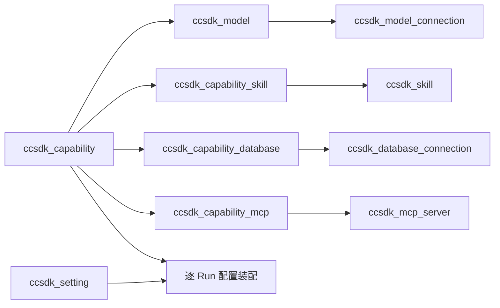

# Runtime 配置中心

MySQL 为唯一可编辑配置来源；2026-11-13 用户要求替代 Nacos，见 [ADR-039](../ADR/039-mysql-runtime-configuration.md)。启动引导、秘密及热更新边界统一见 [配置说明](../../config/README.md)。

## 表关系

共十张表，以稳定 ref 引用，模型目录独立维护，能力只保存 model_ref；推理参数和执行预算直接放能力表。能力和关联在同一事务保存。没有发布表、历史版本、model_profile 或本地配置后端；updated_at 仅表示最近修改时间。MCP allowed_tools 为可用操作名列表，空列表不授权操作，`*` 表示该 MCP 全部操作；能力工具选择仍由可信管理端维护。

## 管理入口

`/internal/config/v1/{resource}` 支持 GET 列表；`/{resource}/{ref}` 支持 GET、PUT 完整保存、PATCH 局部保存、DELETE。resource 为 capabilities、skills、models、model_connections、database_connections、mcp_servers、settings。GET 单条能力包含 skills/databases/mcps 关联；PATCH 省略列或关联保留原值，显式提交关联数组则替换该组，空数组清空该组。ref 不可修改，PATCH 不创建记录。引用中的连接不得删除；基础 settings 和 conversation 不可删除。新 Skill 只接受文本资源，不上传 Python、可执行插件或任意入口。

管理 JWT 使用 settings/system.auth_configuration_jwt_secret，HS256，aud=ccsdk-config，scope=configuration.manage，iss 与 auth_runtime_jwt_issuer 一致，包含 sub/iat/exp，最长 300 秒；与执行、观测密钥分离。拒绝浏览器 Origin，第三方可信后端负责签发与管理端授权。普通 Run JWT 不能修改配置。管理读取脱敏；秘密传 null 保留原值；GET 返回 configured_secrets 表示是否已配置，秘密只在服务端运行装配时解密。

GET /internal/config/v1/models 支持 connection_ref、enabled 过滤，按 sort_order、ref 排序；同连接的 model_name 唯一，不同连接可登记同名模型。GET /internal/config/v1/options 返回 models、tools、skills、mcp_servers、database_connections 选项；只列启用资源，模型还要求连接启用，不返回连接秘密。模型下拉属于管理端，普通 Run 仍只能提交 Capability。

系统设置只有 settings/system 一条记录，固定列按 runtime_*、file_*、image_*、auth_* 分组。能力附件限额、执行/提示词模式、数据源 TLS/查询限制和 MCP Token 注入规则均拆列。协议参数、Header、短数组和文本资源仍用 JSON/加密文本，前端可用键值行或多选编辑；字段定义以 config_store.py 为准。

字段错误返回 HTTP 400，detail 包含 resource/ref/field/code，校验失败整笔回滚；依赖启用能力的模型不能直接停用，先切换能力引用或停用能力。模型支持选项及秘密语义见配置说明。

保存校验通过即生效。每次执行读取最新配置，已有 Run 不受编辑影响，同会话下一 Run 重新装配；停用阻止后续执行，不取消在途 Run。无需重启即可更新规则、Skill、模型连接、数据连接、MCP 和能力预算。进程对象及鉴权常量的设置仍须重启，见配置说明。

## 执行预算

- run_timeout_ms：模型执行阶段截止时间，附件准备和排队使用各自限额。
- tool_timeout_ms：单次工具从 PreToolUse 到完成 Hook 的时间；超限中断本 Run，沿统一清理路径退役连接。
- max_turns：SDK 支持的最大轮数；max_tool_calls：工具入口预占计数，包含失败尝试。
- max_model_calls、max_total_tokens：按 SDK stream 用量观察并中断，Token 包含输入、输出及缓存输入。供应商隐藏重试和未上报用量无法精确计算，不能当作计费硬配额。
- max_output_tokens：单次模型输出上限，通过协议扩展参数发送；受供应商协议约束。

模型执行、凭据绑定和文件交付均使用同一 Run 配置；实际能力、规则、Skill、模型和预算的非秘密信息随 Run 保存，不保存连接凭据。真实 Java 授权、撤销、文件 ACL 和 OS 隔离仍须独立验收。
